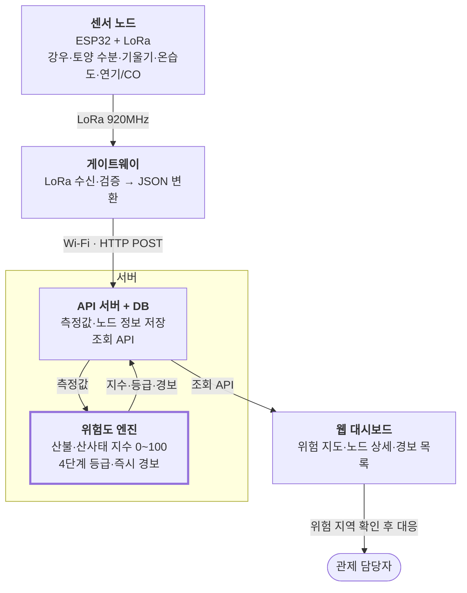

# 3. 시스템 구성

데이터는 센서 노드 → 게이트웨이 → 서버 → 위험도 엔진 → 웹 대시보드 순으로 한 방향으로 흐른다.

노드는 LoRa로만 통신하고, 인터넷 연결은 게이트웨이 한 곳에서만 필요하다. 판단 로직은 서버 쪽 위험도 엔진에 모여 있어 노드 펌웨어를 바꾸지 않고 기준을 조정할 수 있다.

## 구성요소별 역할

| 구성요소 | 역할 | 담당 | 관련 요구사항 |
| --- | --- | --- | --- |
| 노드 펌웨어 | 센서 측정, LoRa 송신, 이벤트 즉시 송신 | 고희경 | [FR-N01~N05](functional.md#41) |
| 게이트웨이 | LoRa 수신, 패킷 검증, 서버 전달 | 임동섭 | [FR-G01~G03](functional.md#42) |
| 서버 | 데이터 저장, 노드 관리, 조회 API | 임동섭 | [FR-S01~S04](functional.md#43) |
| 위험도 엔진 | 산불·산사태 지수, 등급, 즉시 경보 | 임동섭 · 김태호 | [FR-R01~R05](functional.md#44) |
| 웹 대시보드 | 위험 지도, 노드 상세, 경보 표시 | 조연우 · 임동섭 | [FR-W01~W10](functional.md#45) |
